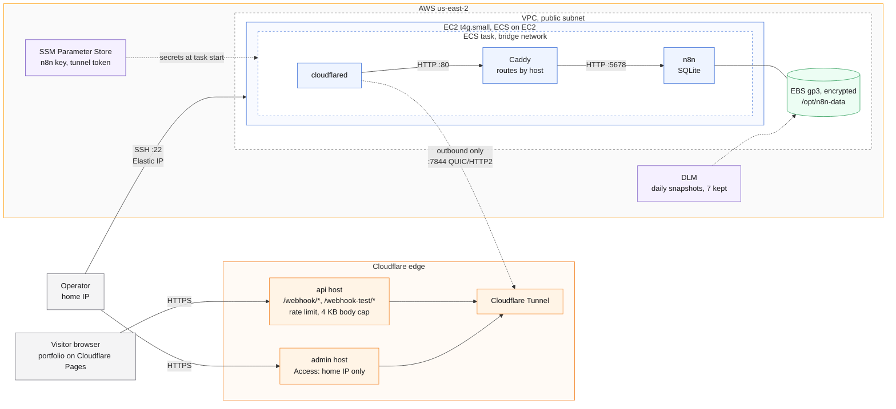

# Networking

- No web port is open on the instance.
  `cloudflared` dials out to Cloudflare, and requests come back over that connection.
- SSH from the home IP is the only inbound rule.
- The rate limit covers `/webhook` paths on the whole zone, because the free plan cannot scope it to one host.
  The 4 KB body cap is set in Caddy on the api host.
- The admin host is reachable only from the home IP through Access.
- The task reads its secrets from SSM when it starts, so none are in the task definition.
